# decad

[![DeepWiki](https://img.shields.io/badge/DeepWiki-lestrrat--3d%2Fdecad-blue.svg?logo=)](https://deepwiki.com/lestrrat-3d/decad)

<p align="center">
  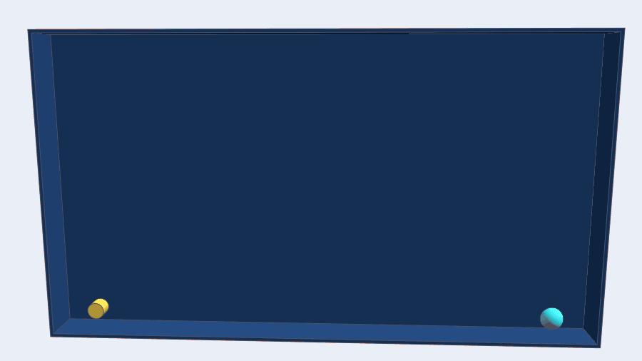
</p>

A **headless CAD engine** for Go. You build 3D parts in code, then check them:
whether each body is a closed, valid solid, what its volume is, whether bodies
interfere, and whether any wall is thinner than a minimum you state.

> **Work in progress.** The API and supported capabilities may change.

decad is the 3D modeling layer above the
[sketch](https://github.com/lestrrat-3d/sketch) 2D constraint engine and the
[r3](https://github.com/lestrrat-3d/r3) coordinate-math layer. It needs no CAD
application, no GUI and no network.

## What decad does

In decad you describe a part the way you would in a CAD application, but as a
Go program. You draw a 2D sketch and give it dimensions, then apply features
to it one after another: extrude it, cut a hole, round an edge, join it to
another body. Running the program builds the part. Change a dimension and run
it again, and decad rebuilds the whole part with the new value, the same way
every time.

What sets decad apart from a program that only produces a shape is that it can
tell you whether the shape is right. `Document.Verify` checks that each body is
a closed, valid solid, that no two bodies overlap, and that no wall is thinner
than the minimum you set. Volumes, areas and centroids come with a stated
error bound, so you know how far to trust the number. A check that decad
cannot settle is reported as undecided, never silently passed, and
`Report.Passed` is true only when every check was proven.

decad also checks parts that move. `VerifyLinkage` follows a chain of joints,
including closed loops such as a four-bar linkage, and proves that no two
parts collide anywhere in a stretch of the motion, not only at the poses it
sampled. The `dynamics` package drops bodies under gravity and simulates
impact and friction (see [Motion and collisions](#motion-and-collisions)).
When you need the result elsewhere, decad writes STEP, IGES, STL, OBJ, 3MF,
glTF, DXF, PNG and G-code, and reads STL, OBJ, 3MF, STEP and IGES files.

## Quick start

```
go get github.com/lestrrat-3d/decad
```

```go
// A solved 2D profile: a 100 x 60 plate on the XY plane.
w := sketch.NewWorld()
s, _ := w.CreateSketch(w.XY())
rect := s.CreateRectangle(0, 0, 100, 60)
s.Fix(rect.A)
s.Solve(ctx)

// Extrude it 10 mm, then verify the document.
doc := decad.New()
body, _ := decad.Extrude(ctx, doc, s, s.Profiles()[0],
	decad.Distance{D: units.Millimeters(10), Dir: decad.Along})
report, _ := doc.Verify(ctx)
vol, _ := body.Volume()

fmt.Println(vol.Value, vol.Exactness) // 60000 mm^3 Exact
fmt.Println(report.Status, report.Passed()) // Sound true
```

The snippet drops error handling for length. The checked version is
[`example_quickstart_test.go`](example_quickstart_test.go), and
[`examples/`](examples) holds runnable examples by feature, each with output
that `go test` checks.

## What you can do

| Task | What decad offers |
|---|---|
| Build | Extrude, Revolve, Sweep, Loft and Coil, from sketch profiles that may hold fit splines, with a surface-result option that leaves a sheet body. SheetMetal builds a bent strip and reports its flat length. |
| Modify | Fillet, Chamfer, Shell, Draft, Hole, Thread, Boss, WebPath ribs, Emboss, Thicken and Offset. |
| Combine | Union, Cut, Intersect and Split, plus Copy, Mirror, linear, circular and path patterns, and Arrange, which lays bodies side by side on a flat bed. |
| Surfaces | Patch, Stitch, Unstitch, Trim and Extend on sheet bodies. |
| Parametrize | Feature values read by name or expression from a `sketch` parameter table. Edit the table and run the program again to rebuild. `Document.Bindings` lists every value read. |
| Read | Volume, area, centroid, bounds, mass properties, topology, surface and curve geometry, cross-sections, point location and distance, and tessellation with an error bound. |
| Verify | Watertightness and solid validity, interference, clearances, minimum wall thickness, mold undercuts and concave radii, each with a typed diagnostic when a check fails. |
| Move | `VerifyMotion` for one joint path, `VerifyLinkage` for joint chains and closed loops, `VerifyJointBox` for a box of joint values, `ContactPair` and `SweepPair` for contact, and the `dynamics` package for rigid-body timelines. |
| Assemble | The `parts` package names parts and joints, draws an exploded view and a connection diagram, checks declared joints against the geometry, and writes a bill of materials. |
| Import and export | STL, OBJ and 3MF meshes, STEP solids with plane, cylinder, cone and sphere-cap faces, and planar-faced IGES solids read in as mesh bodies. STEP, IGES, STL, OBJ, 3MF, glTF, DXF, PNG and G-code are written out. |

## Why this exists

A designer who wants a parametric part works in a CAD application. They draw
sketches, give them dimensions, and add features such as extrusions and cuts.
When a dimension changes, the application rebuilds the part from those steps.

Coding agents can generate 3D shapes, and some are good enough for a one-off
render or print. But if you ask for a bevel gear built to given dimensions, a
shape that looks like a gear is only the start. Its teeth have to mesh with
its mate. A fresh request to the agent may also produce different
geometry, which makes a dimensioned part hard to reproduce.

With decad, a Go program builds and checks the model. With the program and
inputs held fixed, **the same model can be rebuilt** without a fresh request to
the agent. The program can measure volume and centroid, check whether bodies
interfere or have enough clearance, and ask whether a wall is too thin for a
cutting tool. An agent can change a dimension or feature, run the program
again, and read the new verification report.

decad suits trying a design before committing to it. An agent can model a part
here, prove it sound, and only then write the add-in that builds it in Autodesk
Fusion or another CAD application, so a wrong dimension shows up in a test run.
Decad does not try to match the speed of a CAD application, and the agent still
checks the part in that application, because it may interpret the steps
differently.

## Gallery

Each animation shows intermediate decad bodies rendered from the triangle
meshes decad tessellates.

<table>
<tr>
<td>
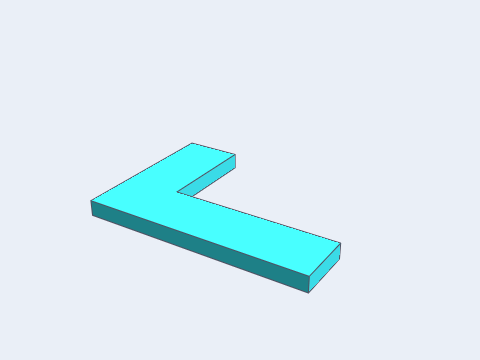<br>
<strong>Extrude</strong> sweeps a solved 2D profile straight into a solid.
</td>
<td>
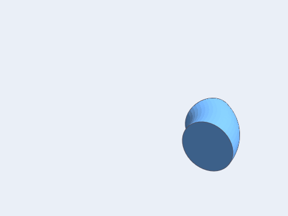<br>
<strong>Revolve</strong> spins a profile about an axis, so a curved generator gives a curved solid.
</td>
</tr>
<tr>
<td>
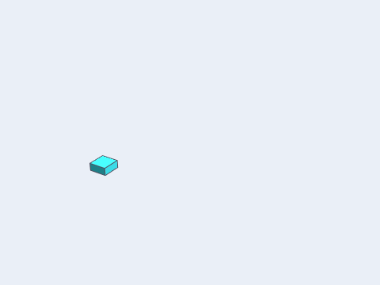<br>
<strong>Sweep</strong> carries one profile along a path with two rounded bends and a straight run.
</td>
<td>
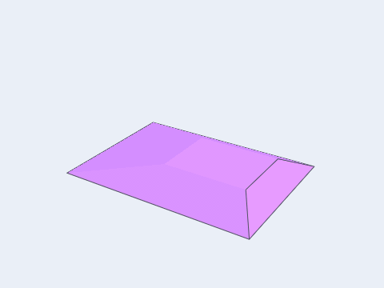<br>
<strong>Loft</strong> rules a wall between two profiles on different planes.
</td>
</tr>
<tr>
<td>
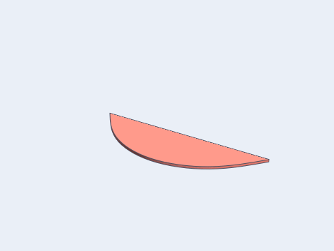<br>
<strong>Free-form profiles</strong> shape a section with fit splines; Extrude carries those curves into the solid walls.
</td>
<td>
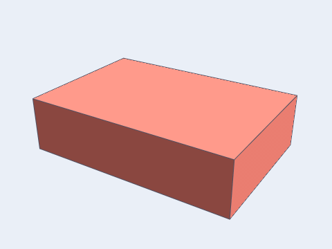<br>
<strong>Fillet</strong> rounds selected edges into tangent arcs.
</td>
</tr>
<tr>
<td>
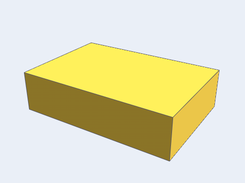<br>
<strong>Chamfer</strong> cuts selected edges back to a straight bevel.
</td>
<td>
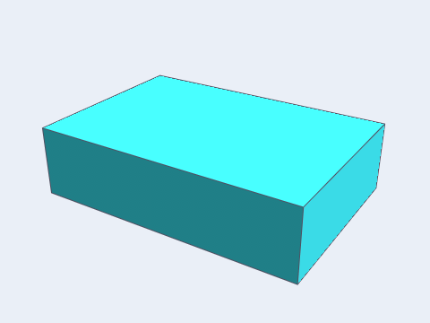<br>
<strong>Cap-loop chamfer</strong> bevels a whole rim, the lead-in a bore or a lid needs.
</td>
</tr>
<tr>
<td>
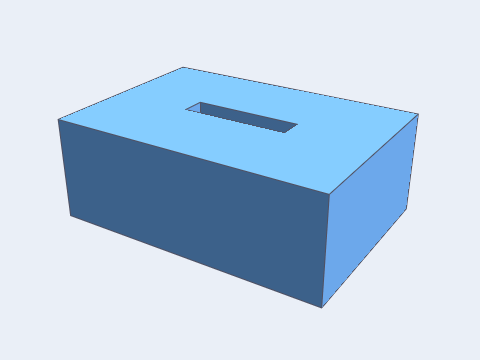<br>
<strong>Shell</strong> hollows a solid into a wall of one thickness.
</td>
<td>
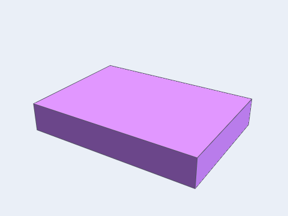<br>
<strong>Union, Cut and Intersect</strong> combine two bodies explicitly, never folded into a feature.
</td>
</tr>
<tr>
<td>
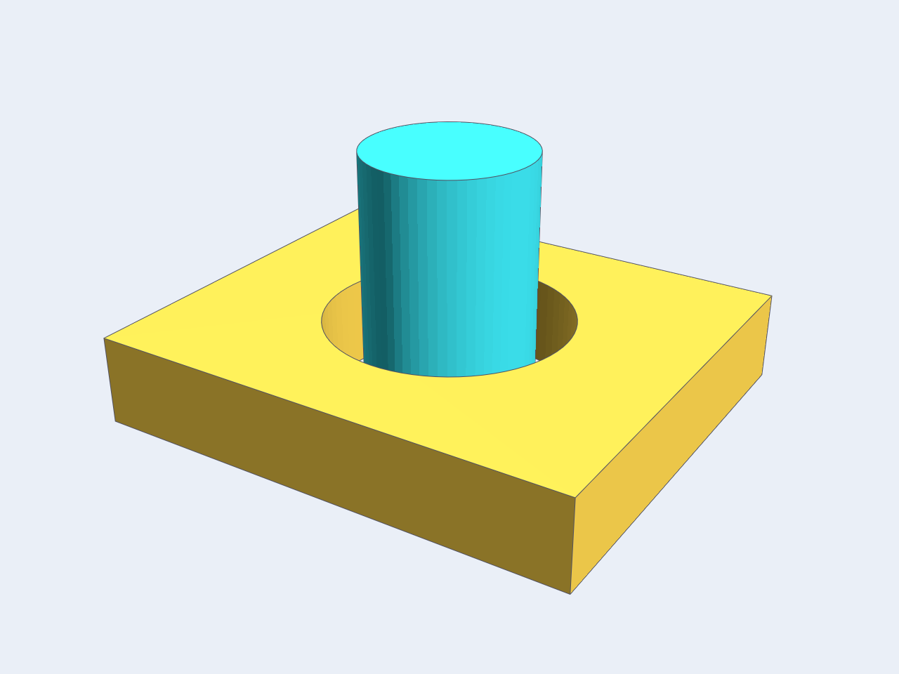<br>
<strong>Verify</strong> reports whether bodies interfere and measures their gap when clearance is requested.
</td>
<td>
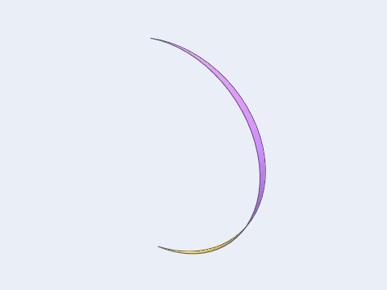<br>
<strong>Surface result</strong> keeps a feature's swept walls and omits the faces that exist only to close the solid,
leaving a sheet body.
</td>
</tr>
<tr>
<td colspan="2">
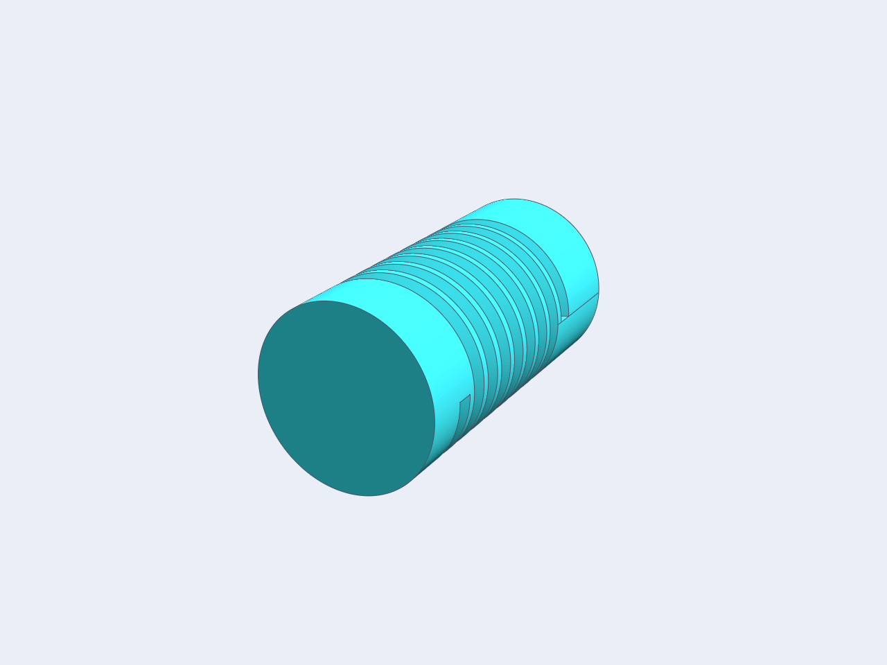<br>
<strong>Coil and Cut</strong> sweep a V-groove around a cylinder and cut it through one end.
The result has faceted faces. Its solid validity is proven, but <code>Verify</code> reports
<code>Suspect</code> because area, volume and centroid bounds exceed the default tolerances.
This example does not specify a standard thread or a mating fit.
</td>
</tr>
</table>

Regenerate the gallery GIFs with `cd _gallery && go run . features` (requires
`ffmpeg`). The still images can be regenerated with `go run .`; use `go run . -only thread`
for the thread image. From `_gallery`,
regenerate the animated hero with `go run . hero > hero-assemble.sh && sh hero-assemble.sh`.
Its letters assemble, a light crosses them, the finished logo holds for ten
seconds, and the letters lift away before the loop repeats.

The landing-page clip animates several gallery parts, a curved duct, and the wordmark. Render it with
`cd _gallery && go run . clip > assemble.sh && sh assemble.sh`: the program
writes each shot's PNG frames under `_gallery/out/` and prints the two ffmpeg
commands, which the script runs to write `out/decad-landing.mp4` and
`out/decad-landing.gif`.

## Motion and collisions

decad also checks parts that move. `Document.VerifyMotion` moves bodies along one
revolute, prismatic or `Between` path. `Document.VerifyLinkage` drives a chain of
joints, including a closed loop such as a four-bar or a slider-crank.
`Document.VerifyJointBox` checks every combination of joint values in a box.
Each check splits the motion into intervals, or the box into cells, and reports
each one as clear, colliding, or undecided. For a clear interval, decad proves
that no two bodies overlap at any point in it, not only at sampled poses, and
reports a lower bound on the gap. A colliding interval has a proven, measured
overlap at one of its ends. An undecided interval makes the report `Suspect`, and
decad does not count it as clear.

The `dynamics` package simulates rigid bodies under gravity, impact and
friction, for the shape and motion paths the
[collision support guide](agent-docs/collision-v1-support.md) lists. The
[box collision example](examples/dynamics_box_collision_example_test.go) runs an
impact and reports the rebound. A `dynamics.Timeline` advances a scene one
fixed step at a time. A step
that its proofs cannot settle returns `Undecided` with a typed reason, and the
timeline stops there. Every frame below is a pose the check or the timeline
computed. The two linkage clips drive each mechanism out to the last pose the
check proves clear, just short of its first proven collision, and back. The
link and the stop it would hit flash coral while the clip pauses there.

<table>
<tr>
<td>
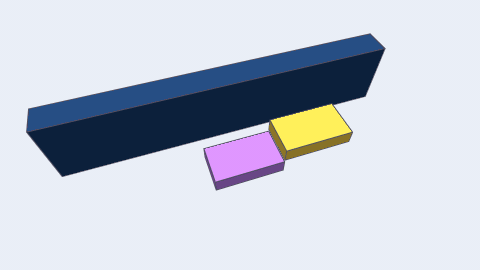<br>
<strong>VerifyLinkage</strong> proves the folding arm clear up to s = 91/256, with the forearm all but
on the stop: the exact contact is at s = asin(17/32)/90° ≈ 0.3566 and the first proven collision at
92/256. The clip drives to 91/256 and back. At every pose the check evaluates, each pin sits on
its bore's centre and measures 0.5 mm clear of it.
</td>
<td>
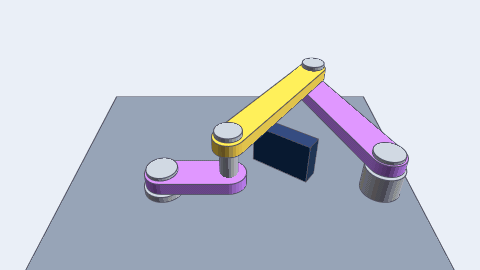<br>
<strong>Closed loops</strong> are checked too: VerifyLinkage proves the crank-rocker clear up to
s = 118/256 (crank angle 165.94°), just before the follower's flank reaches the stop at a crank
angle of 167.62°; its first proven collision is at 120/256. The clip drives to 118/256 and back.
All four pins sit on their bores' centres and measure 0.5 mm clear of them at every pose the
check evaluates.
</td>
</tr>
<tr>
<td>
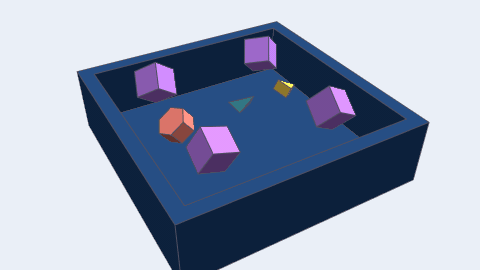<br>
<strong>Tumble</strong> runs all 768 steps of its 3 s timeline, and every body ends at rest on a face,
with at least three vertices within 10 µm of the tray floor.
</td>
<td>
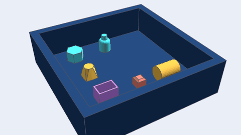<br>
<strong>Parts bin</strong> drops a shelled cup, a chamfered block, a loft, a swept hexagon and a
revolved bottle to rest, while a cylinder rolls 60 mm without slipping.
</td>
</tr>
</table>

Regenerate these GIFs with `cd _gallery && go run . motion` (requires `ffmpeg`).
The same scenes render as full-size PNG frames under `_gallery/out/` with
`go run . linkage`, `go run . linkage -scene rocker`, and
`go run . dynamics -scene tumble` or `-scene parts-bin`. A third dynamics scene,
`-scene stack-and-drop`, drops spheres and a cylinder beside a resting box
pyramid.

Run **Refresh gallery images** from the GitHub Actions tab to regenerate
`stills`, `features`, `hero`, `motion`, or `all`. The optional `only` input passes
comma-separated image names to the selected renderer. Leave it blank for all
images in that group. When images change, the workflow pushes a new branch and
links to a page where you can open a pull request.

## Assemblies and export

The `parts` package names the placed bodies of one document and the joints
between them. `Set.Explode` pulls each part away along its joint axis and
returns the offsets, label anchors and leader lines for an exploded view.
`parts.WithDerivedExplode` works out the removal order from the tessellated
parts. `Set.Check` compares each declared joint with the faces of the parts it
joins, `Set.BOM` returns the bill of materials, and `Set.Graph` writes the
connection diagram as a Mermaid flowchart. See
[`examples/parts_summary_example_test.go`](examples/parts_summary_example_test.go).

The `export` package writes a body or a whole assembly to STEP, IGES, STL, OBJ,
3MF, glTF, DXF, PNG or G-code. `export.STEPItems` and `export.ThreeMFItems`
write several bodies as named, placed parts of one file.

## Layering

```
decad    3D bodies, features, verification   (this module)
         subpackages: export, dynamics, parts, decadtest
  |
sketch   parametric 2D constraint solving    github.com/lestrrat-3d/sketch
  |
r3       vectors, frames, rigid transforms   github.com/lestrrat-3d/r3
  |
units    typed quantities (Value, Kind)      github.com/lestrrat-3d/units
```

decad builds solids and sheet bodies, records their topology, applies features
and booleans, and runs the verification checks (solid validity, interference,
clearance, wall thickness). Every scalar measurement it returns, and every
error bound, is a `units.Value`. Positions are `r3.Vec` in millimetres.

decad asks `sketch` its 2D questions: whether a profile closes, whether a
sketch is fully constrained or over-constrained, where two curves intersect,
and how a set of curves divides a plane into regions. decad also builds
private `sketch` scenes from its own recorded geometry and reads the regions
back. When `sketch` reports a curve fragment as approximate, decad rejects
the input instead of repairing it.

`r3` provides vectors, frames and rigid transforms. decad does all coordinate
math, including local-to-world conversion, through `r3`. `r3` leaves shapes
out of its scope; its README states the rule as *"if it lives in ℝ³, it
belongs here; if it is a shape, it does not."*

[`units`](https://github.com/lestrrat-3d/units) provides typed quantities (`Value`
and `Kind`). decad and `sketch` share it, so lengths, angles and error bounds
use one unit system.

## Documentation

- [API reference](docs/api.md): every public function, by task.
- [Data structures](docs/data-structures.md): the exported types.
- [`examples/`](examples): runnable Go examples with verified output.
- [`docs/README.md`](docs/README.md): the index of user documentation.

## License

This project is **source-available**, and is licensed under the
[PolyForm Noncommercial License 1.0.0](LICENSE).

* **Noncommercial use is free.** Individuals, hobby and personal projects,
  research, education, nonprofits, and government may use, modify, and
  redistribute it at no cost, subject to the license terms.
* **Commercial / business use requires a separate license.** Any use by or for
  a business, or for commercial advantage, is not permitted under the
  noncommercial license. To obtain a commercial license, reach out on Bluesky
  at [@lestrrat.bsky.social](https://bsky.app/profile/lestrrat.bsky.social).

### Contributions

This repository does **not** accept external pull requests.
